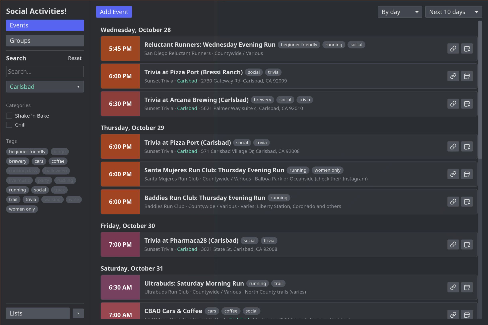

# San Diego Social Activities

A desktop app for browsing groups and events in San Diego County where you
actually take part (hiking, volleyball, board games, language exchanges,
dancing), as opposed to watching. 

Built with Rust, [Iced](https://iced.rs) 0.14 and SQLite.



The app starts with the lists published at
[vishaldpatel.github.io/social-group-and-event-lists](https://vishaldpatel.github.io/social-group-and-event-lists/):
run clubs, game nights, group classes, cars & coffee meetups and more. Some
start out turned off; switch them on in Lists. To add a list from anywhere
else, paste its link into Lists → Add from URL, or download it and add the
file. Made a list of your own? Export it and share it there.

## Running

```sh
mise install            # installs the Rust toolchain pinned in mise.toml
cargo run -p sdsa       # optionally: -- --user PATH to use another database
cargo test --workspace
```

## Installing

Download the file for your system from the
[Releases page](https://github.com/vishaldpatel/socialactivities/releases):

| System | File | Install |
|---|---|---|
| Windows | `…-windows-x64-setup.exe` | Run it. Windows may say "Windows protected your PC": choose **More info → Run anyway**. Or use the portable `.zip`. |
| macOS | `…-macos-universal.dmg` | Open it and drag the app to Applications. The first time, macOS refuses to open it: go to **System Settings → Privacy & Security** and press **Open Anyway**. |
| Debian, Ubuntu, Mint | `….deb` | `sudo apt install ./sd-social-activities_*.deb` |
| Fedora, openSUSE | `….rpm` | `sudo dnf install ./sd-social-activities-*.rpm` (openSUSE: `sudo zypper install`) |
| Arch, Manjaro | `….pkg.tar.zst` | `sudo pacman -U sd-social-activities-*.pkg.tar.zst` |
| Other Linux | `…-linux-x86_64.tar.gz` | Unpack it and run `sdsa`. |

The warnings on Windows and macOS are because the app isn't code-signed.

## Releasing

`.github/workflows/release.yml` builds every package above.

1. Copy the hosted run clubs list over `data/defaults.json` (see
   [Curating the built-in list](#curating-the-built-in-list)).
2. Bump `version` in the root `Cargo.toml`, run `cargo build` so
   `Cargo.lock` follows, and commit.
3. `git tag v0.2.0 && git push origin v0.2.0` (the tag must match the version).
4. When the workflow finishes, a draft release with all the files is waiting
   on the Releases page. Check it, edit the notes, and publish.

Actions → Release → Run workflow builds everything without releasing, to try
changes to the packaging. Packaging files live in `packaging/`; after editing
`packaging/icon.svg`, run `packaging/make-icons.sh` (needs `rsvg-convert` and
ImageMagick) and commit the results.

## Keyboard

| Keys | Does |
|---|---|
| Ctrl+E / Ctrl+G / Ctrl+L | Events / Groups / Lists |
| Ctrl+N | New event, group or list, depending on the panel |
| Ctrl+S | Jump to the search box |
| Ctrl+R | Jump into the panel on the right (its first button, or a form's first field) |
| ↑ ↓ / Page Up, Page Down / Home, End | Scroll the panel on the right |
| Tab / Shift+Tab | Next / previous field, button, tag, checkbox or "By day"/"Next N days" dropdown (text is selected on arrival; the view scrolls to it) |
| ↑ ↓ (or ← →) on a highlighted dropdown | Previous / next option |
| Enter or Space on a highlighted button or checkbox | Press or toggle it |
| F1 (or the "?" button beside Lists) | Open or close help; Esc also closes it |
| Pick… (or ↓ in the date field) | Open the calendar: arrows move by day/week, Page Up/Down by month, Enter picks, Esc closes |

The location dropdowns (search panel and forms) also take Tab: Up/Down step
through places, Enter or Space opens the list, Esc closes it. Each region has a
color (North County seafoam, San Diego City blue, East County amber, South
County pink), used in those lists and for the neighborhood name on cards; they're
in `crates/app/src/location.rs`.

Dates are entered as MM-DD-YYYY (slashes and YYYY-MM-DD also work); list
files store them as YYYY-MM-DD. The forms' other dropdowns can't take keyboard
focus yet, so Tab skips them.
Weeks start on Monday. Each event's time sits on a sky color for its start
time (night navy, dawn purple, daytime blue, afternoon gold, sunset orange);
the colors are in `crates/app/src/sky.rs`.

Tags that wouldn't match anything in the panel you're on, given your other
filters, are grayed out. You can still select them, then change other filters
to see what turns up.

Your filters (area, categories, tags) and the Events panel's grouping and
range are remembered between runs, in your database. The search text isn't.

## Layout

```
crates/core          sdsa-core: model, SQLite storage, list files, recurrence (no UI)
crates/app           sdsa: the Iced desktop app
data/defaults.json   the built-in list (run clubs) compiled into the app
packaging/           icons, desktop file, Info.plist, installer and PKGBUILD for releases
```

## Lists

Every group and event belongs to a **list**. Everything lives in one SQLite
database in the platform data dir (e.g.
`~/.local/share/sd-social-activities/user.sqlite`).

- **Lists you own** ("Yours") can be edited, exported and removed; **Edit**
  changes the name, description and update URL. Everyone starts with "My
  List"; the editors' "Save to list" picks which one, defaulting to the list
  you last saved to.
- **Added lists** come from a `.json` file or URL and are read-only. "Check for
  Updates" re-reads the list's update URL (or wherever it was added from) and
  offers the new version only if its `updated_at` is newer. A new version
  without an update URL keeps the one already known. Once a week (checked at
  launch, and while the app is open) every added list is checked on its own
  and newer versions are applied straight away, with a message naming them.
  If none can be reached, it tries again an hour later. Your own events can
  still belong to their groups; they live in your list and survive updates.
- **Choosing an event's group:** if the group is in a list you maintain, "Save
  to list" switches to that list and a note says so. If it isn't, a warning
  explains that the event loses its group should that list be removed or an
  update drop the group.
- **The built-in list** is `data/defaults.json`, compiled into the app: a copy
  of the run clubs list hosted on the [lists site](https://vishaldpatel.github.io/social-group-and-event-lists/). It's
  installed on first run and replaced whenever a newer copy ships, unless you
  maintain it or removed it. Its update URL points at the hosted file, so
  "Check for Updates" gets changes between releases. (The earlier built-in
  list, "San Diego Social Activities", is removed on launch unless you
  maintain it.)
- **The lists catalog** at
  [`index.json`](https://vishaldpatel.github.io/social-group-and-event-lists/index.json)
  is checked on every launch. Any list in it that you don't have, and haven't
  removed, is added read-only and updates from its URL. An entry with
  `"default_on": false` is added turned off. That's only on the first launch
  that reaches the catalog: lists that show up in it later are always added
  turned off, with a message saying which. Lists you already have are left
  as they are, and if the catalog can't be reached the app carries on and
  tries again next launch. Run clubs are also built in, so a first launch
  offline still has something to show.
- **Turning a list off** (the On/Off switch on its card) hides its groups and events
  from the Events and Groups panels, its tags from the tag filter, and its
  groups from the event editor's group picker. Nothing is deleted, and the
  list still updates. Your own events in a list that's on still show, even
  when their group's list is off. Lists stay off until you turn them back on;
  removing a list forgets it.

Hidden groups are remembered by id across all lists. Group and event ids must
be unique across lists; adding a list that reuses another list's ids is
refused.

The list file format is defined in `crates/core/src/listfile.rs`.

## Curating the built-in list

The run clubs list is maintained on the [lists site](https://vishaldpatel.github.io/social-group-and-event-lists/), at
`SanDiegoCounty/run-clubs.json`.

1. In the app's Lists panel, add that file with **I maintain this list**
   ticked. It becomes editable on your machine and is never overwritten by the
   bundled copy or by updates.
2. Edit its groups and events as usual. Each edit bumps its `updated_at`.
3. **Export…** it and publish it to the site. Keep its **Update URL** (Lists →
   Edit) set to the hosted file, so everyone's copy keeps updating from there.
4. Before a release, copy the hosted file over `data/defaults.json` so new
   installs start with the latest version.
